This is the start-to-finish setup guide. Once the server is online, use the operator pages named after each portal tab for day-to-day administration.

<div class="video-embed">
  <iframe
    src="https://www.youtube.com/embed/ciur3Iesvzs"
    title="Setting up a DXRP community server"
    frameborder="0"
    allow="accelerometer; autoplay; clipboard-write; encrypted-media; gyroscope; picture-in-picture; web-share"
    allowfullscreen></iframe>
</div>

## 1. Sign in and select your network

Go to [dxrp.net](https://dxrp.net), sign in with Steam, and open the portal.

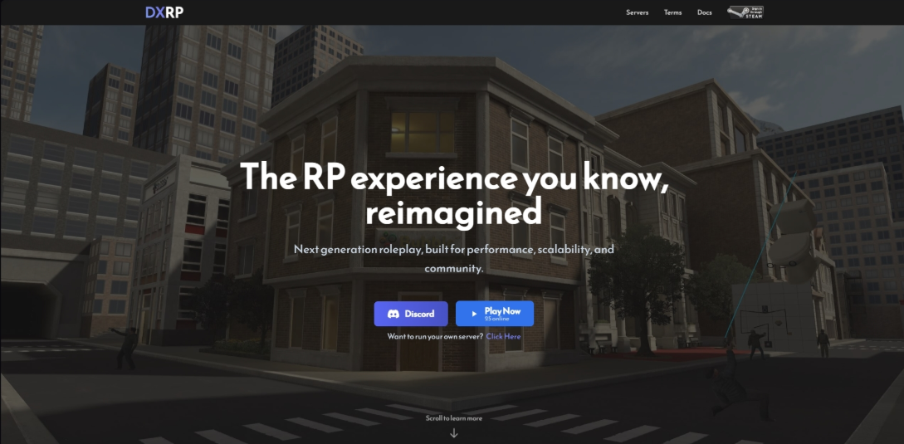

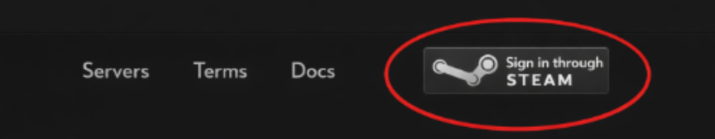

The network selector in the top-right controls which community you are managing. Check it before making changes if you belong to more than one network.

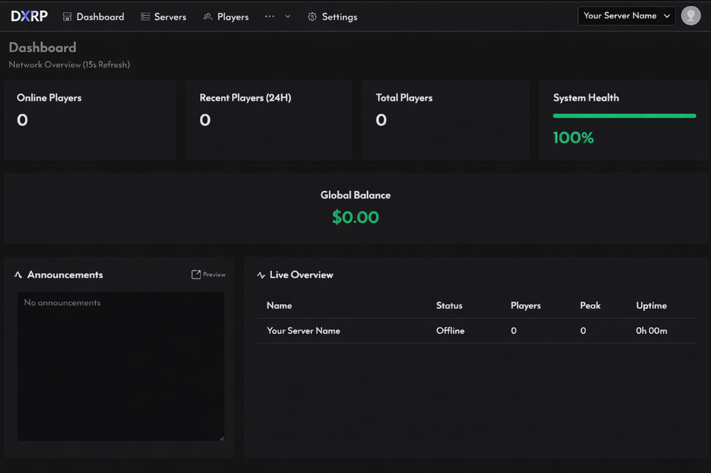

## 2. Open your server

Open **Servers**. Create a server if your network does not have one yet; otherwise select its name to open the management page.

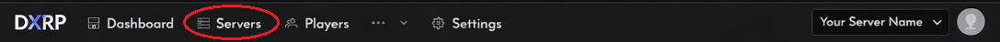

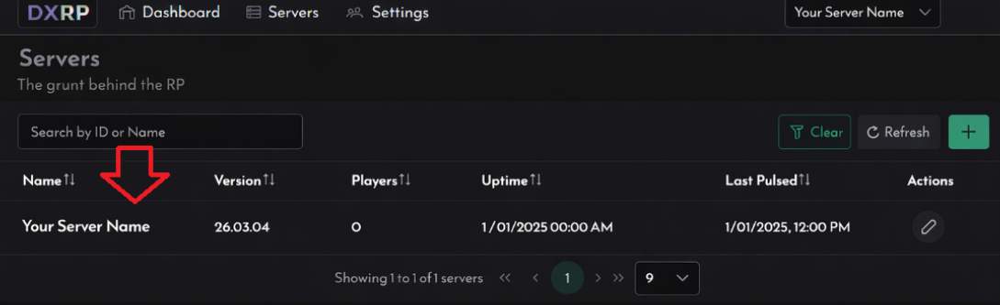

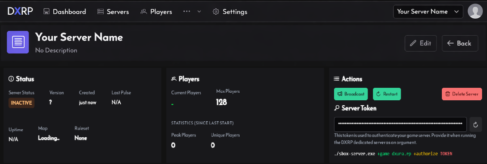

The [Servers reference](/docs/operators/operations/servers) explains every field and action on this page.

## 3. Choose a map

Select **Edit**, choose a map, and save.

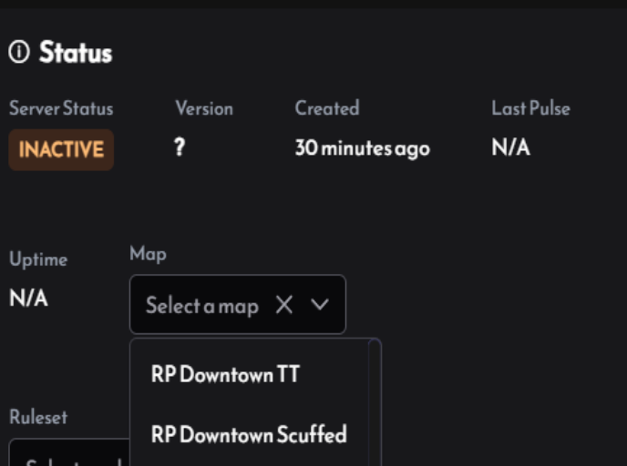

If the map is not listed, open **More → Maps**, add it using the last part of its s&box URL with `/` replaced by `.`, then return to the server and select it. A custom map can also carry prefab JSON for its DXRP fittings.

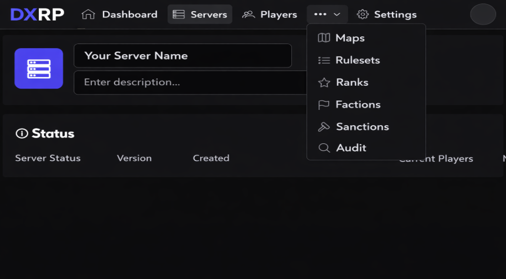

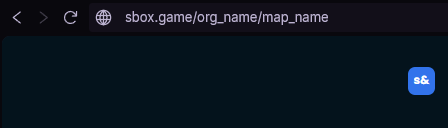

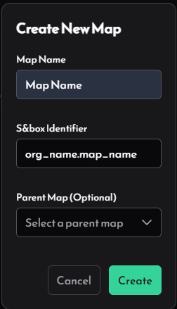

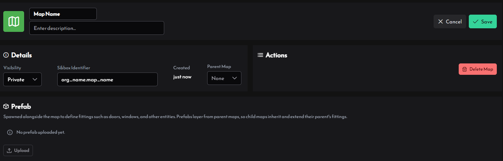

See [Maps](/docs/operators/operations/maps) for map identifiers, parent maps, prefab uploads, and public-map approval.

## 4. Generate the authorization token

On the server page, select **Regenerate Token** in **Actions**. The token is shown once and copied to your clipboard, so put it directly into your launch command or secret store.

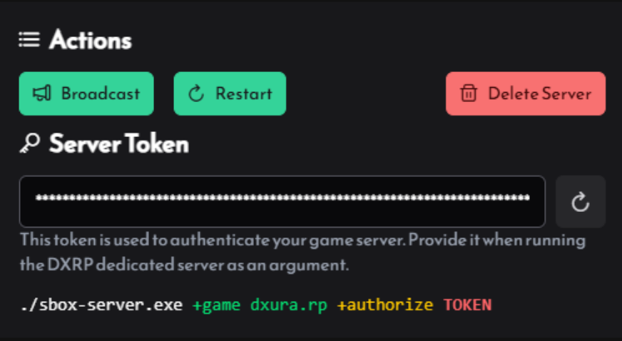

Regenerating the token invalidates the previous token. Do it again only when the current token is lost or exposed.

## 5. Start on Windows

Open a terminal in the s&box installation directory, normally:

```
C:\Program Files (x86)\Steam\steamapps\common\sbox
```

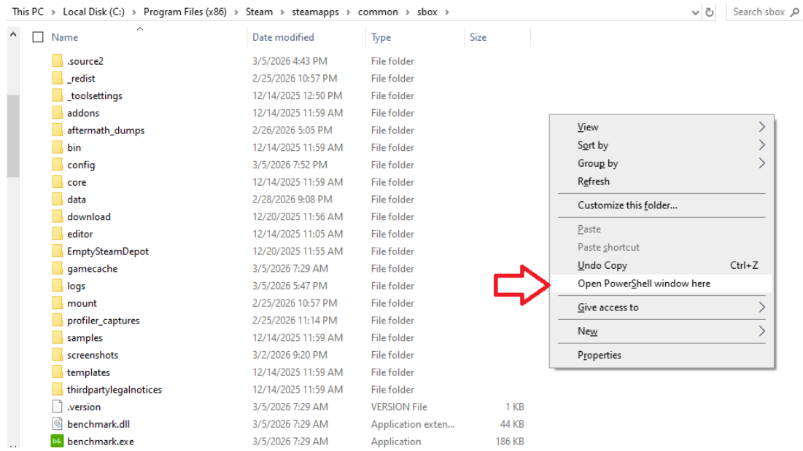

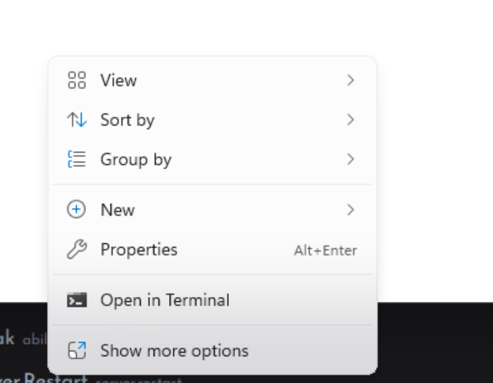

Run:

```powershell
./sbox-server.exe +game dxura.rp +authorize TOKEN
```

Replace `TOKEN` with the token from step 4.

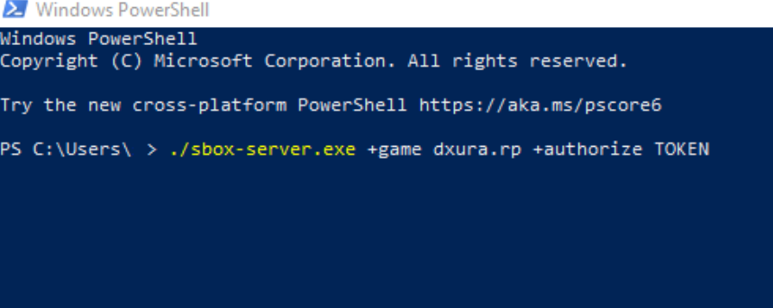

### Optional restart loop

Save this as `start-server.bat`, update the executable path and token, then run the file instead of launching the executable directly:

```bat
@echo off
:start
"C:\Program Files (x86)\Steam\steamapps\common\sbox\sbox-server.exe" +game dxura.rp +authorize YOUR_TOKEN_HERE
timeout /t 5 /nobreak
goto start
```

## Run the DXRP repository launcher

Use the repository launcher when your server needs DXRP revision bundles installed before startup. The normal s&box server command does not download and extract DXRP launcher bundles.

From a directory containing `sbox-server.dll` and the launcher script:

```powershell
dotnet run dxrp-server.cs --token YOUR_TOKEN
```

The launcher requires the .NET SDK and Git. On its first run it creates `dxrp-server-config.json`, stores the token, fetches the configured DXRP repository, asks the API for the addons attached to the server’s game mode, clears the generated addon directories, downloads code/assets packages, and launches the server. Keep the config file private; it contains the server token and is ignored by the root repository.

For a safe development check, run with a checkout containing `game/`. The launcher detects this as development mode, asks for confirmation, patches the existing addon directories, and does not launch the server. Use `--patch-only` with a normal server installation when you want package patching without launching.

If the launcher stops at preflight, check that `sbox-server.dll` is in the current directory. If it reports an API error, verify the token and the server’s network connectivity. If an addon fails to build with verification enabled, inspect the first reported C# error before restarting.

## 6. Start with Docker on Linux

The `dxura/sbox:latest` image runs the server through SteamCMD:

```bash
docker run -d --restart unless-stopped dxura/sbox:latest +game dxura.rp +authorize <TOKEN>
```

Replace `<TOKEN>` with the token from step 4. Standard s&box server arguments can be appended to the command.

## Confirm it is online

Return to **Servers** and check its status, player count, uptime, and health. A new server can take a moment to check in.

Next, configure [Game Modes](/docs/operators/operations/game-modes), [Rulesets](/docs/operators/operations/rulesets), and [Ranks](/docs/operators/community/ranks), or return to [Dashboard](/docs/operators/dashboard) for the network-wide overview. The [official s&box dedicated-server documentation](https://sbox.game/dev/doc/networking-multiplayer/dedicated-servers/) covers additional launch arguments.
